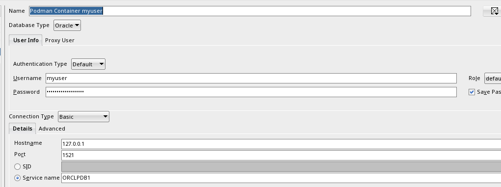

# Ghid de Instalare și Configurare Oracle Database 19c (Podman)

Acest ghid descrie pașii necesari pentru descărcarea, rularea și configurarea unei instanțe containerizate de **Oracle Database 19c Enterprise Edition** folosind `podman` și `podman-compose`.

## 1. Configurarea contului și licențierea pe Oracle Container Registry

Pentru a putea descărca imaginea oficială a bazei de date, este necesară autentificarea pe registrul de containere furnizat de Oracle.

1. **Crearea contului Oracle:**
   Dacă nu dețineți deja un cont, înregistrați-vă pe platforma oficială:
   <https://profile.oracle.com/myprofile/account/create-account.jspx>

2. **Acceptarea termenilor de licențiere:**

   * Accesați registrul de containere: <https://container-registry.oracle.com/>

   * Autentificați-vă cu datele contului creat.

   * Navigați la secțiunea **Database** -> **enterprise**.

   * Acceptați termenii și condițiile de utilizare (*Oracle Standard Terms and Restrictions*).

3. **Generarea unui Auth Token:**

   * Din profilul contului de pe platforma Oracle, generați un **Auth Token** dedicat autentificării CLI. Acesta va fi folosit pe post de parolă în linia de comandă.

## 2. Autentificarea și descărcarea imaginii

Deschideți un terminal pe calculatorul personal și executați următorii pași:

### Pasul 1: Autentificarea în registrul Oracle

Executați comanda de autentificare:

```
podman login container-registry.oracle.com

```

* **Username:** Adresa de email asociată contului Oracle.

* **Password:** Auth Token-ul generat.

### Pasul 2: Descărcarea imaginii

Descărcați imaginea containerizată pentru versiunea Enterprise 19.3.0.0:

```
podman pull container-registry.oracle.com/database/enterprise:19.3.0.0

```

> ⚠️ **Notă:** Imaginea are o dimensiune de aproximativ **8.37 GB**. Asigurați-vă că aveți o conexiune stabilă la internet și spațiu de stocare suficient.

## 3. Administrarea containerului cu `podman-compose`

Toate comenzile de mai jos se execută în directorul care conține fișierul de configurare `docker-compose.yml` (sau `compose.yaml`).

| Comandă | Descriere / Efect | 
| ----- | ----- | 
| `podman-compose up` | Creează și pornește containerul în mod interactiv. Terminalul rămâne blocat; oprirea terminalului va opri și baza de date. | 
| `podman-compose up -d` | Creează și pornește containerul în fundal (*detached mode*). Puteți închide terminalul fără a opri serviciul. | 
| `podman-compose stop` | Oprește containerul în mod sigur (*non-distructiv*). Starea și datele sunt conservate. | 
| `podman-compose start` | Repornește un container oprit anterior. | 
| `podman-compose down` | Oprește și elimină containerul și rețeaua asociată. **Datele din volumul fizic rămân intacte.** | 
| `podman-compose down -v` | **Atenție:** Oprește și elimină containerul împreună cu volumele interne gestionate de Podman. | 
| `podman-compose logs -f` | Afișează fluxul de log-uri ale containerului în timp real (`-f` menține conexiunea deschisă). | 

> 🕒 **Atenție la prima pornire:** Inițializarea bazei de date (*DBCA process*) durează între **5 și 10 minute**. Baza de date este pregătită pentru conexiuni doar după ce în log-uri apare mesajul:
>
> ```
> #########################
> DATABASE IS READY TO USE!
> #########################
> 
> ```

## 4. Configurarea inițială a utilizatorului de lucru

Pentru respectarea bunelor practici de securitate, se recomandă crearea unui utilizator dedicat în loc de utilizarea directă a contului administrativ `SYS` / `SYSDBA`.

### Pasul 1: Conectarea la utilitarul `sqlplus` în container

Rulați clientul `sqlplus` din interiorul containerului cu drepturi administrative:

```
podman exec -it oracle19c sqlplus / as sysdba

```

### Pasul 2: Crearea schemei și alocarea drepturilor

În consola `sqlplus`, executați următoarele comenzi (înlocuind `myuser` și `MyStrongPassword123` cu datele dorite):

```
-- Comutarea contextului în Pluggable Database (PDB)
ALTER SESSION SET CONTAINER = ORCLPDB1;

-- Crearea utilizatorului
CREATE USER myuser IDENTIFIED BY "MyStrongPassword123";

-- Alocarea rolurilor principale
GRANT CONNECT, RESOURCE, DBA TO myuser;

-- Alocarea spațiului nelimitat de stocare pe tablespace-ul USERS
ALTER USER myuser QUOTA UNLIMITED ON USERS;

```

### Convenții privind numele de utilizator în Oracle

* **Standard (Recomandat):** Utilizați caractere alfanumerice neseparate prin semne de punctuație (ex. `student1`, `gabriel_preda`). Oracle le va stoca automat cu majuscule (`MYUSER`), permițând autentificarea indiferent de caracterele mari/mici introduse în clienți.

* **Atenție la caractere speciale / puncte (ex: `"gabriel.preda"`):** Dacă numele de utilizator conține puncte sau alte caractere speciale, **trebuie obligatoriu încadrat în ghilimele duble** la creare. Acest lucru va face numele *sensibil la litere mari/mici (case-sensitive)*, impunând folosirea ghilimelelor la orice conectare ulterioară sau interogare SQL.

## 5. Parametrii de conexiune pentru clienți SQL (DBeaver / SQL Developer)

După finalizarea pașilor de configurare, vă puteți conecta din orice mediu de dezvoltare (IDE) folosind următorii parametri:

* **Host / Hostname:** `127.0.0.1` *(sau `localhost`)*

* **Port:** `1521`

* **Connection Type:** Basic

* **Service Name:** `ORCLPDB1`

* **Username:** `myuser` *(sau numele ales)*

* **Password:** `MyStrongPassword123` *(sau parola aleasă)*

* 
*Figura 1: Ecranul de configurare a conexiunii în Oracle SQL Developer.*

# All set, grab a coffee! ☕
